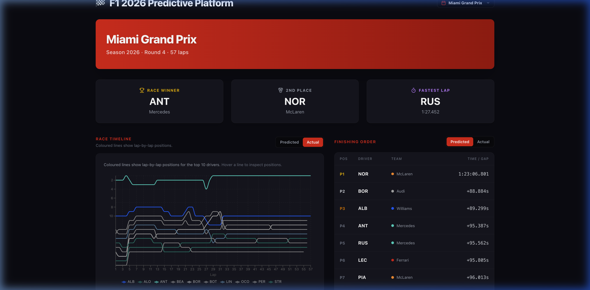
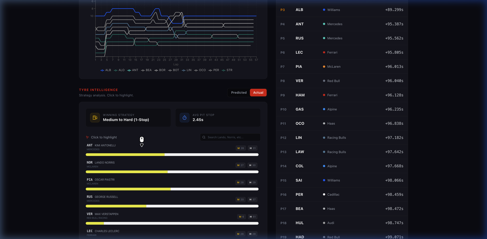
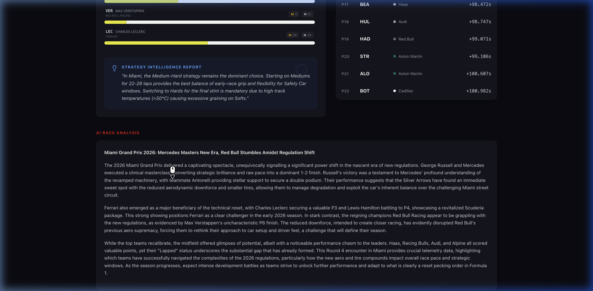
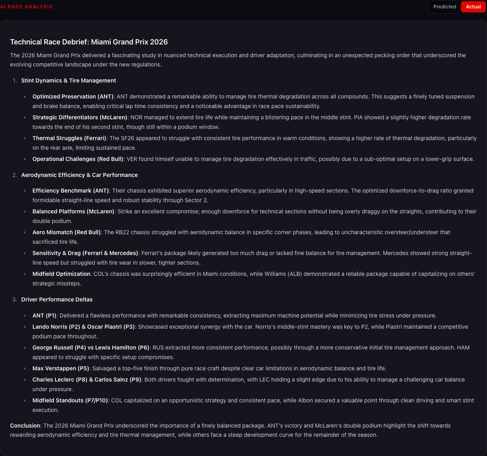

# F1 2026 Season Predictive Platform 🏎️📊🤖

[](https://github.com/JuanjoRestrepo/f1_2026_predictions/actions/workflows/docker.yml)
[](https://github.com/JuanjoRestrepo/f1_2026_predictions/actions/workflows/ci.yml)
[](https://github.com/JuanjoRestrepo/f1_2026_predictions/actions/workflows/ci.yml)

A production-grade, end-to-end MLOps platform designed to predict Formula 1 race dynamics for the 2026 regulation era. This system combines state-of-the-art Gradient Boosting (XGBoost/LightGBM) with a high-fidelity interactive dashboard inspired by F1 TV telemetry.

📖 **Detailed System Architecture**: For a comprehensive technical deep-dive into the Databricks Lakehouse, DLT Medallion layers, Quantile Regressors, LLM Fallback Chain, and Next.js ISR architecture, see [docs/ARCHITECTURE.md](docs/ARCHITECTURE.md).

---

## 📸 Platform Interface Preview

### 1. Dashboard Header



### 2. Race Timeline & Global Standings

Interactive position chart with real-time "Predicted vs Actual" toggle.


### 3. Tyre Strategy Intelligence

AI-driven stint analysis and business question engine for optimal pit-stop windows.


### 4. AI-Generated Race Narratives

Expert-level race reporting powered by configurable **Gemini 3.1 Pro** primary generation with **Gemini 3.5 Flash** fallback, analyzing telemetry residuals and strategic outcomes with professional engineering personas.


---

## [v6.4.1] - 2026-10-17

### 🎯 Pace-Normalisation Correctness, an Honest CI Gate & Credential Hygiene

- **Fix**: Driver pace is now measured per circuit (`scripts/simulate_race.py`). The simulator subtracted a season median pooled across every circuit in the window, which mostly measured *which* tracks a driver had laps at — the window mixes circuits 13s apart, so 52–54% of some drivers' laps came from a short circuit and inflated them by 6–8s. Each lap is now referenced to its own round's baseline, reduced to one observation per round, and sector times follow the window-to-track ratio. Driver delta spread for round 18: 13.554s → 4.897s.
- **Fix**: `Validate DABs Bundle` now validates. It exited 0 whenever `DATABRICKS_HOST` was unset, and since the secret was never configured it had validated nothing since it was added, leaving the bundle checked only at `bundle deploy` time. `scripts/validate_bundle.py` now decides everything that needs no workspace (YAML validity, include targets, in-bundle file references, `environment_key`/`depends_on` integrity, `${var.*}` / `${resources.*}` substitutions, `resources:` typos) on every pull request, and `databricks bundle validate` activates by itself once credentials exist.
- **Fix**: The manual `scheduled_sync.yml` fallback asked for `secrets.F1_GEMINI_API_KEY` while the repository secret is `GEMINI_API_KEY`; because a present-but-empty env var beats the config's alias, every manual run silently produced non-AI narratives. It also built zero notification channels and exited 0 — a green run that briefed nobody. The name is corrected, the missing secrets are set, and a credential check now annotates the run page with `::warning::` for anything still absent.
- **Fix**: The next-race availability guard (`scripts/check_next_race_coverage.py`) fails loudly in the weekly `sync_calendar.yml` workflow when the upcoming race cannot be rendered, instead of the dashboard quietly greying it out.
- **Changed**: `scripts/rotate_supabase_s3_keys.py` rotates the Supabase S3 pair across `.env` and the Databricks `f1_secrets` scope, with the runbook in `CONTRIBUTING.md` recording that the pair lives in exactly two places.
- **Security**: Rotated the Supabase S3 key pair (the retired pair now returns HTTP 403, verified against the bucket), documented the rotation runbook and the fact that the pair lives in exactly two places, and removed the retired keys, the five stale GitHub Actions secrets and the local `.env.bak.*` backups that held them.
- **Docs**: `ARCHITECTURE.md` §4.1/§4.2 corrected to the serving path actually in use, and §3.3 now records that the Actions fallback keeps its own credential store; `CONTRIBUTING.md` distinguishes the two bundle checks.

---

## [v6.4.0] - 2026-10-17

### ☁️ Single-Orchestrator Consolidation & Databricks → Dashboard Serving

- **Feature**: `export_dashboard_data` Lakeflow task publishes the season's `reports/<season>` bundle to S3-compatible storage; the dashboard's `prebuild` step (`dashboard/scripts/fetch-dashboard-data.mjs`) pulls it back, keeping the web app live without a GitHub Actions race cron.
- **Feature**: Real FastF1 ingestion (`--run-mode ingest`) lands completed-round laps in the Unity Catalog `raw_telemetry` Volume; `telemetry_bronze` now tails it via Auto Loader instead of sample data.
- **Feature**: Champion promotion gate — `@champion` is only re-tagged when the candidate beats the incumbent's CV RMSE.
- **Changed**: Retired the Trigger.dev orchestration (sources, config, CI job, SDK deps) and the GitHub Actions race cron; Databricks Lakeflow is now the single scheduler. The Actions race workflow remains as a manual `workflow_dispatch` fallback.
- **Security**: Cleared every open CodeQL alert and moved CI onto Node 24 actions (`upload-artifact` v7, `download-artifact` v8, `setup-buildx-action` v4, `setup-uv` v10.3.0, …). Added `CONTRIBUTING.md` documenting the trunk-based branch model.
- **Fix**: Post-race verdicts no longer fabricate accuracy when lap timing or results are unavailable — they degrade to explicit `preview`/`partial` statuses.

---

## [v6.3.0] - 2026-10-04

### 🇪🇸 Madrid GP, Dynamic Priors & Unity Catalog Model Registry

- **Feature**: Madrid GP standalone prediction pipeline (`scripts/madrid_prediction_external.py`) integrating FastF1 ETL, clean-air lap filtering, Bayesian shrinkage and Stacking ML inference.
- **Feature**: Dynamic form priors and a circuit-similarity engine replace static pre-season assumptions with EWMA form deltas computed from actual results.
- **Feature**: Unity Catalog Model Registry lifecycle verified (`main.race_pace.xgb_race_pace_regressor` tagged `@champion`) with Databricks Secrets-backed email dispatch.
- **Security**: Added `SECURITY.md`, weekly Dependabot scanning and CodeQL analysis (`gh-secure`).

---

## [v6.2.1] - 2026-08-23

### 🇳🇱 Dutch GP (Round 12) Pre-Race Simulation

- **Feature**: LightGBM quantile pace predictions and an AI race report for Round 12, plus predicted lap positions and tyre intelligence artifacts.

---

## [v6.2.0] - 2026-08-23

### 📊 Dashboard Telemetry & AI Intelligence Upgrade

- **Feature**: Restructured pre- and post-race AI reports (executive summary, Top-10 pace hierarchy, podium contenders, pit window, watch points).
- **Fix**: Aggregated lap-level predictions into one entry per driver, removing duplicate legend labels in the timeline chart.
- **Fix**: Strict future-race date gating and race-day continuity in the dashboard, with `Barcelona`/`Spanish` GP directory alias resolution.
- **Fix**: `.gitignore` exceptions keep generated `reports/**/summaries/*.json|md` artifacts tracked for deployment.

---

## [v6.1.0] - 2026-08-23

### 🏎️ Race Weekend Auto-Gate & FastF1 Calendar Integration

- **Feature**: FastF1 Ergast 2026+ official calendar integration (`is_race_window_active()`), restricting execution strictly to active Race Weekends (Fri–Sun) and Post-Race Mondays.
- **Feature**: DABs workflow schedule update (`f1_2026_race_predictions_job`) with Quartz cron `0 0 6 ? * FRI-MON`.
- **Fix**: Pinned `@trigger.dev/cli@4.4.6` in `.github/workflows/docker.yml` to resolve CI package version mismatch.
- **Fix**: Databricks Secrets integration for live Gmail SMTP verdict briefings.

---

## [v6.0.0] - 2026-08-23

### ⚡ Databricks Lakehouse & Unity Catalog MLOps

- **Feature**: Databricks Asset Bundles (DABs) infrastructure for zero-touch cloud deployment (`databricks.yml`, `resources/jobs.yml`, `resources/pipelines.yml`).
- **Feature**: Delta Live Tables (DLT) Medallion Pipeline (`Bronze` → `Silver` → `Gold`) for automated telemetry ingestion, expectation validation, and driver feature aggregation.
- **Feature**: MLflow 3 & Unity Catalog Model Registry integration with automated promotion to `@champion` / `@challenger` aliases.
- **Feature**: Serverless Lakeflow Workflow (`f1_2026_daily_predictions_job`) orchestrating DLT updates, XGBoost champion retraining, and multi-channel briefings.

## [v4.4.4] - 2026-05-28

### 🛡️ DevOps & Data Science Alignment

- **Feature**: Strict `pre-commit` framework enforcement (`ruff`, `mypy`, `pytest`).
- **Fixed**: Resolved 12 NPM vulnerabilities via targeted `package.json` overrides.
- **Improved**: Perfect synchronization between local validation hooks and GitHub Actions CI pipelines.

## [v4.4.3] - 2026-05-25

### 🎨 Autonomous UI & End-to-End Formatting

- **Feature**: End-to-End Fastest Lap automation dynamically extracting telemetry without hardcoded fallbacks.
- **Improved**: Integrated KaTeX plugins to perfectly render complex LaTeX SHAP formulas in AI reports.
- **Fixed**: Eliminated duplicate driver rows in the Predictions table by accurately aggregating multi-lap ML forecasts.

## [v4.2.0] - 2026-05-06

### 🎨 The "High-Fidelity UI" Release

- **Feature**: Systematic readability overhaul across the entire dashboard.
- **Improved**: Hierarchical typography for section titles and subtitles (16px/14px desktop scale).
- **Improved**: Increased legibility for tyre stints, metric labels, and search fields.
- **Improved**: Responsive `prose-base` scaling for AI Race Analysis reports.
- **Fixed**: Syntax nesting issues in `TyreIntelligence` component and React title tag warnings.

## [v4.1.0] - 2026-05-06

### 🚀 The "Autonomous Autopilot" Release

- **Feature**: Implemented Friday Pre-Race automation. The system now proactively predicts the race hierarchy before the weekend starts.
- **Feature**: Added `detect_upcoming_race` logic to the core orchestration engine.
- **Improved**: Hardened `master_pipeline.py` to handle "Prediction Mode" gracefully without actual race data.
- **Improved**: Unified GitHub Actions workflow for both Friday (Preview) and Monday (Audit) cycles.

## [v4.0.0] - 2026-05-06

### 🏁 Industrialization & Stability Milestone

## 🌟 Key Features

- **Industrialized Inference API**: High-performance FastAPI microservice for real-time lap time predictions.
- **⚡ Databricks Lakehouse & DLT**: Production-grade Medallion architecture (Bronze/Silver/Gold) deployed via Databricks Asset Bundles (DABs) on Serverless compute.
- **🎯 Unity Catalog & MLflow 3**: Automated experiment tracking and `@champion` / `@challenger` model promotion in Unity Catalog.
- **🔄 Autonomous Workflow (Event-Driven)**: The system operates on a professional, autonomous cycle via GitHub Actions & Databricks Lakeflow Jobs:
  1. **Friday @ 18:00 UTC**: **Pre-Race Mode**. Runs ML simulations to generate the "Prediction Preview" briefing.
  2. **Monday @ 09:00 UTC**: **Post-Race Mode**. Syncs actual results, calculates MAE/Accuracy, and sends the "Race Verdict" audit.
  3. **Wednesday @ 09:00 UTC**: **Safety Sync**. Re-verifies data in case of official delays.
- **Multi-Channel Intelligence Dispatch**: Automated race briefings delivered via F1-branded HTML emails and Discord cards.
- **Multi-Platform Docker Infrastructure**: Automated builds for `amd64` (servers) and `arm64` (Apple Silicon) using parallel GitHub Actions pipelines.
- **2026 Regulation Awareness**: Custom feature engineering including `Era Normalization` (adjusting historical times to 2026 rules) and `PU Strain Index`.
- **Track Evolution Intelligence**: Captures "rubbering-in" effects through rolling pace potential analysis.
- **Differentiated Analysis**: Unique AI narratives for both **Actual Results** (post-race debrief) and **Predicted ML Simulations** (pre-race forecasting).

### 🧠 Advanced Predictive Engine (v4.4.0+)

- **Meta-Learning (Stacking)**: Blends XGBoost and LightGBM base models using a Bayesian Ridge meta-regressor, achieving exceptional sub-0.150s MAE precision.
- **Leak-Free Validation**: Internal 5-fold cross-validation ensures meta-models train without data leakage.

### 🤖 Autonomous Orchestration (v4.3.0+)

Race-weekend orchestration is owned by a **single scheduler: Databricks Lakeflow Jobs** (`resources/jobs.yml` → `f1_2026_race_predictions_job`, Quartz cron `0 0 6 ? * FRI-MON` UTC). One orchestrator means one source of truth — no duplicate briefings and no racing git writes from competing schedulers.

The job chains serverless tasks:

1. **`ingest_race_telemetry`** — pulls the just-completed round's FastF1 laps into the Unity Catalog Volume `/Volumes/<catalog>/<schema>/raw_telemetry` (the real Bronze drop).
2. **`run_medallion_pipeline`** — Lakeflow Spark Declarative Pipeline: Bronze (Auto Loader over the Volume) → Silver (DLT quality expectations) → Gold (driver feature aggregates).
3. **`train_and_register_champion`** — trains the pace regressor and promotes `@champion` in Unity Catalog **only when the candidate beats the incumbent champion's CV RMSE**; otherwise it registers `@challenger`.
4. **`dispatch_notifications`** — sends the post-race Gmail/Discord verdict briefing.
5. **`export_dashboard_data`** — publishes the season's `reports/<season>` bundle to object storage so the web dashboard refreshes (runs in parallel with notifications; non-fatal).

The old GitHub Actions Friday/Monday/Wednesday cron and the Trigger.dev scheduled tasks have been retired; the GitHub Actions race workflow is kept as a **manual fallback** ("Run workflow" in the Actions UI) for replaying a run by hand.

### 📡 Databricks → Dashboard Serving Path

With orchestration owned by Databricks, the cloud job is also the **producer** for the web dashboard. The channel has two halves:

1. **Publish (Databricks)** — the `export_dashboard_data` task runs `databricks_entrypoint.py --run-mode export`, which collects `reports/<season>/**` and uploads it to S3-compatible storage (the same Supabase bucket/credentials as the FastF1 cache) under a `dashboard/<season>/` prefix:

   ```text
   dashboard/<season>/manifest.json    ← written LAST: its presence means "bundle complete"
   dashboard/<season>/<relative path>  ← mirrors reports/<season>/ exactly
   ```

   Only dashboard artifact types are published (`.json`, `.csv`, `.md`, `.png`, `.svg`, `.html`, `.txt`). Publishing is best-effort: a missing bucket or credentials logs a warning instead of failing the job.

2. **Consume (dashboard)** — the Next.js build pulls the bundle back into the local `reports/<season>/` layout before `next build`, via `dashboard/scripts/fetch-dashboard-data.mjs` (wired as the `prebuild` script). This keeps `dashboard/src/utils/fileReader.ts` unchanged and works with the committed data as a fallback.

Enable consumption by pointing the dashboard at the published bundle:

```bash
F1_DASHBOARD_DATA_BASE_URL=https://<project>.supabase.co/storage/v1/object/public/<bucket>/dashboard/2026
# F1_DASHBOARD_DATA_TOKEN=...        # optional, for private buckets
# F1_DASHBOARD_SEASON=2026           # default 2026
# F1_DASHBOARD_DATA_STRICT=1         # fail the build instead of falling back
```

Left unset, the sync is a no-op and the dashboard uses the committed `reports/` files — so local development and existing deployments are unaffected.

### 🧱 Databricks Lakehouse Deployment (DABs)

1. Validate bundle:
   ```bash
   databricks bundle validate --target dev
   ```
2. Deploy to Databricks workspace:
   ```bash
   databricks bundle deploy --target dev
   ```
3. Run the race-weekend workflow:
   ```bash
   databricks bundle run --target dev f1_2026_race_predictions_job
   ```

### 🛠️ Core Engine Setup

1. **Environment**: Ensure you have `uv` installed.
2. **Sync**: `uv sync`
3. **API Keys**: Add `F1_GEMINI_API_KEY` (and, for Databricks runs, your workspace credentials) to your `.env`.
4. **Gemini Models**: The default AI narrative stack is `F1_GEMINI_MODEL=gemini-3.1-pro-preview` with `F1_GEMINI_FALLBACK_MODEL=gemini-3.5-flash`. `gemini-3.1-pro-preview` requires usable API quota/billing in Google AI Studio; otherwise the pipeline falls back to Flash or local engineering copy.

### 🛠️ Technical Retrospective & Lessons Learned

- **The "Headless" Dependency Trap**: Encountered a build failure where `kaleido` (the static chart engine) required Linux system libraries (`libnss3`, `libatk`, etc.) that were missing in the slim Docker image. Resolved by adding a dedicated graphics-dep layer to the `Dockerfile`.
- **CI Linting Granularity**: Discovered that `ruff check` passes don't guarantee `ruff format --check` passes. Standardized the local development workflow to always run `uv run ruff format` before pushing to avoid CI blocking.
- **Strategy Pattern Payoff**: The decision to use the Strategy Pattern for notifications allowed us to pivot from a simple print statement to a full Gmail/Discord integration in under an hour without touching core business logic.

---

### 🏗️ Platform Architecture

```text
├── .github/workflows/       # CI/CD Automation (Docker & CI)
├── databricks.yml           # Databricks Asset Bundle (DABs) Root Config
├── databricks_entrypoint.py  # Databricks Lakeflow Job Entrypoint
├── resources/               # DABs Resource Definitions (Jobs & Pipelines)
│   ├── jobs.yml             # 5-Task Lakeflow Orchestration Workflow
│   ├── pipelines.yml        # Delta Live Tables (DLT) Medallion Pipeline Spec
│   └── volumes.yml          # Unity Catalog Volume for raw FastF1 telemetry
├── src/f1_predictions/      # Core Python Package (ML, API, Databricks)
│   ├── api/                 # FastAPI Inference Service
│   ├── databricks/          # DLT Medallion Pipeline & MLflow 3 UC Integration
│   ├── features/            # Feature Engineering (Reliability, Evolution, Era)
│   ├── modeling/            # Optuna Tuning & Training Logic
│   └── models/              # Model Persistence & Base Classes
├── dashboard/               # Next.js 15 Web Application
├── Dockerfile               # Multi-stage Optimized Build
├── data/outputs/models/     # Production Model Artifacts (*.joblib)
├── scripts/                 # Master Pipeline (Orchestrator)
└── tests/                   # Pytest suite (>80% coverage)
```

---

## 🚀 Execution Workflow

### 1. Inference API (Docker)

The easiest way to run the prediction engine:

```bash
docker pull ghcr.io/juanjorestrepo/f1_2026_predictions:latest
docker run -p 8000:8000 ghcr.io/juanjorestrepo/f1_2026_predictions:latest
```

Access the API docs at `http://localhost:8000/docs`.

### 2. Local Development

```bash
uv sync
uv run uvicorn f1_predictions.api.main:app --reload
```

### 3. Update Race Data

To ingest and analyze any Grand Prix (e.g., Canada Round 5, Spain Round 6):

```bash
uv run scripts/master_pipeline.py --round [ROUND_NUM]
```

---

## 🛠️ Technical Stack

- **ML & Inference**: `FastAPI`, `XGBoost`, `LightGBM`, `Scikit-Learn`, `SHAP`, `Joblib`
- **AI**: `google-genai` (`gemini-3.1-pro-preview` primary, `gemini-3.5-flash` fallback)
- **Frontend**: `Next.js 15 (Pages)`, `TypeScript`, `Tailwind CSS`, `Recharts`, `pnpm` (Workspace & Package Management)
- **Security & Governance**: `gh-secure` (GitHub Security Lab: CodeQL SAST, Dependabot, PVR Security Policy, PR Rulesets)
- **DevOps & Cloud**: `Databricks DLT`, `Unity Catalog`, `Docker (Buildx)`, `GitHub Actions`, `uv`
- **Data Source**: `FastF1 API` & `Open-Meteo Weather API`

---

**Author**: Juan Jose Restrepo Rosero  
**Philosophy**: "Data is just noise without strategy." This platform focuses on converting complex ML residuals into actionable racing intelligence.

---

## 🔮 Future Vision: The "Invincible" Race Agent

The long-term vision for this platform is to move beyond scheduled reporting and into **Durable Agentic Orchestration**. Built on **Databricks Lakeflow Jobs** and Lakeflow Spark Declarative Pipelines, we aim to build a "Live Race Assistant" capable of:

- **Durable State**: Handling multi-hour race events with automatic retries and state persistence across API failures or system restarts.
- **Human-in-the-Loop**: Transitioning to a model where the AI proposes strategic shifts (e.g., "Box now for Intermediates") and waits for human validation before broadcasting briefings.
- **Multi-Agent Coordination**: Scaling to a swarm of specialized agents (Strategy, Weather, and Telemetry) that collaborate via a central durable execution bus.

---

Operational note (Databricks):

- `databricks_entrypoint.py` is the single entry point for every Lakeflow job task (`--run-mode {ingest,train,notify,export}`). It resolves `src/` onto `sys.path` relative to its own location, so it works regardless of the driver's working directory.
