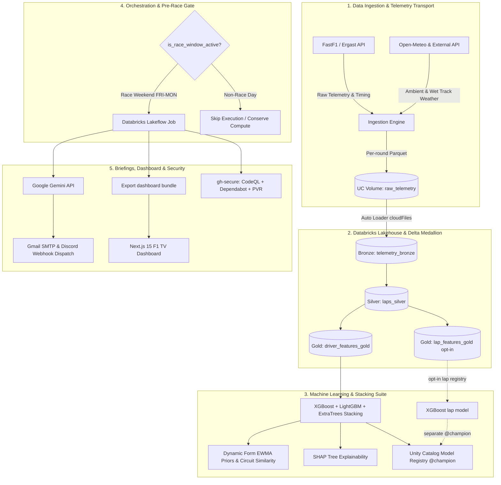

# F1 2026 Predictive Platform — End-to-End System Architecture

## Executive Architecture Summary

The **F1 2026 Predictive Platform** is an enterprise-grade data engineering, machine learning, and full-stack web application designed to forecast and analyze Formula 1 race performance hierarchies under the **2026 technical regulations**.

The system operates as an autonomous, event-driven pipeline that ingests telemetry, executes quantile regression models on a Databricks Lakehouse, registers champion model artifacts in Unity Catalog, generates structured LLM race briefings via Google Gemini, and deploys an interactive Next.js dashboard on Vercel.



---


## 1. Telemetry Ingestion & Data Engineering Pipeline

### 1.1 Ingestion Sources
- **FastF1 Ergast API**: Synchronizes lap times, sector split times (S1, S2, S3), trap speeds, tyre compounds, stint lengths, pit stop durations, and telemetry channels (Throttle, Brake, RPM, Gear, Speed).
- **Open-Meteo Weather API**: Retrieves air temperature, track surface temperature, humidity, wind vectors, and rainfall indicators for circuit coordinates.
- **Cloud Cache Layer**: Caches raw FastF1 payloads in a local directory (`fastf1_cache/`) backed up to a Supabase S3 bucket for warm serverless execution.
- **Unity Catalog `raw_telemetry` Volume**: completed-round FastF1 laps are landed as per-round Parquet under `/Volumes/<catalog>/<schema>/raw_telemetry`, which the Bronze layer tails with Auto Loader (job task 1, see §3.2). This is the real Bronze drop that closes the cloud self-learning loop; when a timing environment cannot supply lap data the round is skipped and post-race verdicts degrade to a positional-only `partial` status rather than inventing accuracy.

### 1.2 Delta Medallion Architecture (Databricks DLT)
1. **Bronze Layer (`telemetry_bronze`)**: Raw, append-only lap telemetry, streamed out of the `raw_telemetry` Volume by Auto Loader (`cloudFiles`) so original data types are preserved.
2. **Silver Layer (`laps_silver`)**: Cleaned and validated dataset with Delta Live Tables (DLT) quality expectations:
   - `expect_or_drop("valid_lap_time", "LapTimeSeconds >= 45.0 AND LapTimeSeconds <= 240.0")`: Removes pit-in/out out-laps and safety car anomalies.
   - `expect_or_fail("driver_not_null", "Driver IS NOT NULL")`: Ensures strict entity integrity.
3. **Gold Layer (`driver_features_gold`)**: per-driver, per-session aggregates for the registry path, race sessions only — `mean_pace_seconds`, `fastest_lap_seconds`, `pace_std_seconds`, `total_laps`, `tyre_degradation_corr`, `tyre_degradation_slope`, `last_ingested_at`.
4. **Gold Layer (`lap_features_gold`, Task 21.3, opt-in)**: per-lap, pre-lap-safe features targeting `LapTime_s`, built by `databricks/pipelines/lap_features.py` from `laps_silver`. It feeds the separate `xgb_lap_pace_regressor` lane; neither the published simulator nor the aggregate champion reads it. The per-lap engineered features the race simulator uses are built by the local pipeline, and the schemas are compared in §3.4.

---

## 2. Machine Learning Modeling & Uncertainty Engine

### 2.1 Model Selection & Justification
In accordance with empirical benchmarks on tabular data (Grinsztajn et al., 2022), tree-based ensemble algorithms significantly outperform deep neural networks on structured telemetry features.

| Model | Purpose | Quantile / Objective |
|---|---|---|
| **XGBoost Regressor** | Primary lap pace baseline | `reg:squarederror` |
| **LightGBM Quantile Regressors** | Uncertainty bounds (P05, P50, P95) | `quantile` ($\alpha = 0.05, 0.50, 0.95$) |
| **Stacking Pace Regressor** | Ensemble meta-learner | Ridge Regression meta-estimator |

This table describes the model families available to the pipeline; it does not mean one artifact serves every surface. §3.4 records which path produces which number, and which of them is metric-gated.

### 2.2 Cross-Track Baseline Pace Normalization
To translate season-wide driver pace onto a specific circuit's physical lap-time baseline:

$$\text{Driver\_Delta}_i = \operatorname*{Median}_{\text{rounds}}\Big(\operatorname*{Median}_{\text{laps}}\big(\text{LapTime} - \operatorname*{Median}_{\text{field, round}}(\text{LapTime})\big)\Big)$$

$$\text{Target\_Pace}_{i, \text{track}} = \text{Baseline}_{\text{historical, track}} + \text{Driver\_Delta}_i$$

$$\text{Sector}_{i} = \text{Field\_Sector\_Level} \cdot r + \text{Driver\_Sector\_Delta}_i \cdot r \qquad r = \frac{\text{Baseline}_{\text{historical, track}}}{\operatorname*{Median}_{\text{field, season}}(\text{LapTime})}$$

$$\text{Speed}_{i} = \text{Field\_Speed\_Level} + \text{Driver\_Speed\_Delta}_i$$

**Why the delta is measured per round.** A driver's median lap time pooled across a season mostly measures *which* circuits they have laps at, not pace: the current-season window mixes circuits whose lap times differ by more than ten seconds. Reducing every lap to its own round's median, collapsing each driver to one observation per round, and then taking the median across rounds removes that confound — a driver who retired at a short circuit can no longer read as seconds per lap faster than a team-mate who did not.

**Why sectors and speeds get the same treatment.** `Sector1Time_s`–`Sector3Time_s` and `SpeedI1`–`SpeedST` reach the model as the same pooled per-driver season medians, so they carry the same confound — more severely. Measured across the current window:

| feature | field spread, pooled | field spread, per circuit | inflation |
|---|---|---|---|
| `LapTime_s` | 13.554 s | 4.897 s | 2.8× |
| `Sector1Time_s` | 9.028 s | 1.816 s | 5.0× |
| `Sector2Time_s` | 24.548 s | 2.051 s | 12.0× |
| `Sector3Time_s` | 24.681 s | 1.504 s | 16.4× |
| `SpeedI2` | 51 km/h | 18 km/h | 2.8× |

Only the field-wide level is carried over from the window; every driver-specific deviation is re-measured per circuit. Sector deviations follow the window-to-track ratio $r$ because sector times are proportional to lap time, whereas speeds are not and stay in km/h.

**Effect on a published round.** Re-running the 2026 United States Grand Prix with the corrected normalization moves the field spread from 6.465 s to 4.920 s against a lap-measured 4.897 s, correlation with measured pace from 0.946 to 0.988, and residual standard deviation from 0.502 s to 0.215 s. Because the corrected inputs now *contain* the measured deltas, the correlation is not independent validation — the defensible claim is that the published spread no longer exceeds what the laps support.

**A removed feature.** `clean_air_pace_delta_s` and `clean_air_confidence` are no longer supplied to the model. They had no counterpart in any of the 77,696 training rows, so no tree could ever split on them: zeroing them left predictions byte-identical. A feature present at inference and absent in training is train/serve skew, not signal. The curated prior behind it remains in service inside the clean-air pace module. §2.3 describes the measurable version of the same idea that replaced it.

**Report boundary.** Reports for rounds 1–17 predate this correction and are left exactly as published rather than retro-fitted; the corrected model applies from round 18 onward.

### 2.3 Traffic Exposure Labels

**What they are.** A race lap is only comparable to another race lap if both were driven in comparable air: a car sitting one second behind another loses tenths to dirty air and to lifting, so a driver's raw lap-time median mixes *pace* with *traffic situation*. Every Gold lap therefore carries three labels, computed from the lap layer itself in `features/traffic_exposure.py`:

| label | meaning |
|---|---|
| `traffic_ahead_s` | gap in seconds to the nearest car ahead |
| `traffic_nearest_s` | gap in seconds to the nearest car either side |
| `in_clean_air` | 1 when `traffic_ahead_s >= 2.0` **and** `traffic_nearest_s >= 1.2`, else 0 |

**How the gaps are measured.** Each lap carries a known on-track interval (`LapStartTime`, `Time`). Every lap is sampled at 20/40/60/80% of its duration, each other car's active lap is mapped to a track position in laps (`LapNumber - 1 + fraction_complete`), and the distance to the focus car — converted through the session's own median lap time — is the gap in seconds. A single global constant cannot do this conversion: one lap of track distance is worth about 70 s at Monza and 120 s at Singapore. Measured on the current window, a fixed 101 s reference misclassifies 4,272 of 77,696 laps (5.5%), and 39 of the 86 rounds sit above 5% misclassification; substituting an independent reference (median lap *duration* instead of median lap *time*) moves the labels by at most 0.0054 s and flips 37 of 77,696. Only laps with durations inside 60–180 s enter the interval set — an in-lap or a stoppage that survived cleaning would poison every other car's margin — and the 37 laps whose margins cannot be computed stay NaN rather than being guessed.

**Does the estimator measure what it claims?** The dirty-air penalty was measured independently of the label definition, by pairing each lap with the nearest clean-air lap of the same driver in the same stint at the same tyre age:

| gap to car ahead | measured penalty | laps |
|---|---|---|
| ≤ 0.5 s | +0.571 s | 319 |
| 0.5 – 1.0 s | +0.291 s | 237 |
| 1.0 – 1.5 s | +0.092 s | 329 |
| 1.5 – 2.0 s | +0.013 s | 513 |

The penalty decays monotonically and reaches the noise floor at 2.0 s, which is where the clean-air threshold was set — measured, not assumed. Coverage after the pass over all 86 rounds: 77,659 of 77,696 laps labelled (99.95%), 44.0% of them clean; median clean-air margins are 4.95 s ahead and 2.98 s nearest.

**Do they help the model?** Ablated on three held-out seasons, paired across 10 seeds (42–51). Every delta except the placebo column belongs to the shipped margins-only variant; the placebo receives the same two columns with their values shuffled within each round:

| held-out season | baseline MAE | delta-MAE, margins | delta-MAE, placebo | delta-MAE, clean-air laps | delta-MAE, traffic-affected laps |
|---|---|---|---|---|---|
| 2024 | 0.227 s | **−0.0092 ± 0.0043** | −0.0026 | −0.0059 | **−0.0120** |
| 2025 | 0.350 s | **−0.0164 ± 0.0048** | +0.0012 | **−0.0121** | **−0.0195** |
| 2026 | 0.208 s | −0.0095 ± 0.0070 | −0.0010 | −0.0058 | **−0.0116** |

Bold marks a change beyond two standard errors. The gain is consistent in direction in all three seasons and the placebo stays at zero, so it is information rather than extra model capacity; the largest improvement is on traffic-affected laps, which is the mechanism the labels encode. The effect on clean-air laps — the laps the product actually simulates — is smaller and not individually significant in 2026, so this is a modest, well-understood gain and not a step change.

**Effect at the product level.** The race simulator was replayed walk-forward over five completed rounds (2025 R22–R24, 2026 R2–R3): train on every lap strictly before the round, serve the clean-air scenario, and compare the predicted driver order with the measured pace. Rank agreement improved in all five rounds (mean Spearman +0.047, from 0.544 to 0.590) and centred lap-time error improved in four of five (mean +0.008 s). These are single fits per round, and a control that keeps the labels in training but serves them missing shows no rank difference — so the product-level gain is directional evidence, not proof; the robust claim remains the lap-level ablation.

**Effect on a published round.** Re-running the 2026 United States Grand Prix moves the published field spread from 4.920 s to 5.093 s against a lap-measured 4.897 s — 1.04×, inside the 1.25 tripwire — and the xgb path's correlation with the all-lap measured pace from 0.9883 to 0.9858, while the P50 quantile path improves (0.9466 to 0.9539; residual 0.474 s to 0.436 s). The simulated lap is a clean-air lap, so the all-lap reference is the mismatched one: against a clean-air-only reference the xgb correlation is unchanged (0.8859 to 0.8858) and the P50 path improves (0.8174 to 0.8426). One round, one fit — reported because it moved, not because it proves anything.

**Why the flag is not a feature.** `in_clean_air` is exactly the two thresholds applied to the two margins, so it carries no information a tree cannot recover by splitting on them itself. Ablated alongside the margins it made every season *worse* (2025: −0.0117 s with the flag vs −0.0164 s without). The two margins are therefore the model features, `in_clean_air` is dropped from every feature matrix via `DEFAULT_DROP_COLS`, and it remains in the Gold frame as a measurement label.

**A refuted alternative.** Measuring driver pace from clean-air laps only was tried and rejected. It improved the average delta error (0.596 s vs 0.624 s) but degraded the ordering — rank correlation of predicted vs measured pace fell from 0.554 to 0.500, worse in 8 of the 10 rounds tested — and ordering is what the product publishes. The per-round delta measurement keeps every lap.

**Serving the simulated lap.** The simulator's virtual lap is a clean-air lap by construction (the scenario builder in `scripts/simulate_race.py`). It is served with the measured clean-air medians (`CLEAN_AIR_SCENARIO`: 5.0 s ahead, 3.0 s nearest) so a scenario row sits where the trees were trained, instead of falling through their missing-value branch. The scenario builder is unit-tested against the trained feature set, because an untested serve contract is exactly how train/serve skew returns.

### 2.4 Chronological Validation (Leakage Prevention)
Models are trained exclusively on historical seasons with known outcomes (e.g. 2022–2025) and tested on unseen future seasons (2026), preventing *temporal* leakage between seasons. It does not address within-lap leakage: several lap-level features are derived from the current lap or the whole stint (recorded in §3.4), so the reported MAE is a reconstruction error rather than an out-of-sample race-prediction error.

---

## 3. Automated Scheduling & Race Weekend Auto-Gate

### 3.1 Race Weekend Auto-Gate (`is_race_window_active()`)
To prevent unnecessary compute usage and spurious notification alerts:
- The system queries `calendar.json` (synced via `src/scripts/sync_calendar.py`).
- **Active Window**: Friday 00:00 UTC through Monday 23:59 UTC on scheduled race weekends.
- **Behavior**: If executed on a non-race day (e.g. Wednesday of a gap week), the pipeline logs a clean skip notification and terminates gracefully with exit code 0.
- **Override**: Passing `--force` CLI flag bypasses the gate for manual testing and CI/CD verification.

### 3.2 Databricks Lakeflow Workflow (`f1_2026_race_predictions_job`)
The Databricks job is the **single scheduler** — the Trigger.dev orchestration and the GitHub Actions race cron have both been retired. Five tasks execute as one dependency graph:

- **Schedule**: Quartz cron `0 0 6 ? * FRI-MON` (race weekend + post-race Monday at 06:00 UTC).
- **Task 1 (`ingest_race_telemetry`)**: pulls the newest completed round from FastF1 and writes per-round Parquet into the Unity Catalog `raw_telemetry` Volume (`--run-mode ingest`).
- **Task 2 (`run_medallion_pipeline`)**: executes the DLT pipeline over that Volume (Bronze → Silver → Gold).
- **Task 3 (`train_and_register_champion`)**: fits the pace regressors, infers the MLflow signature (`infer_signature`), sets the registry URI to `databricks-uc`, and re-tags `@champion` in Unity Catalog (`<catalog>.race_pace.xgb_race_pace_regressor`) — **only when the candidate beats the incumbent's cross-validated RMSE**.
- **Task 4 (`dispatch_notifications`)**: reads credentials from the Databricks Secrets scope `f1_secrets` (`F1_GMAIL_USER`, `F1_GMAIL_APP_PASSWORD`, and optionally `F1_DISCORD_WEBHOOK_URL`) and sends HTML email briefings and Discord alerts via SMTP/webhook.
- **Task 5 (`export_dashboard_data`)**: runs in parallel with task 4 and publishes the season's `reports/<season>` bundle to object storage for the dashboard (see §4.4).

### 3.3 GitHub Actions: Manual Fallback & Calendar Sync
- **`scheduled_sync.yml` — manual only.** The Friday/Monday race cron was removed alongside the Databricks consolidation; the workflow is kept as a `workflow_dispatch` fallback for replaying a single run by hand.
- **The fallback keeps its own credential store: GitHub repository secrets, not `f1_secrets`.** `GEMINI_API_KEY`, `F1_GMAIL_USER`, `F1_GMAIL_APP_PASSWORD` and `F1_RECIPIENT_EMAIL` must all be present for a manual run to produce AI narratives and actually send a briefing. Anything missing is reported as a `::warning::` annotation on the run page, so a green run cannot be mistaken for a delivered notification.
- **`sync_calendar.yml`** keeps its calendar cron so `calendar.json` continues to track the official FastF1/Ergast schedule.

### 3.4 Which Model Produces Which Number
Four model paths exist. They do not share a model, a feature set or a target, so knowing which one produced an artifact is the difference between a defensible claim and reading a number for something it is not.

| Path | Trained by | Data & target | Produces | Metric-gated? |
|---|---|---|---|---|
| **Registry champion** | `databricks_entrypoint.py --run-mode train` (task 3, Fri–Mon 06:00 UTC; production schedule paused pending quota) | Unity Catalog `driver_features_gold` (per-driver aggregates); target `fastest_lap_seconds` | MLflow run + `@champion` / `@challenger` alias on `<catalog>.<schema>.xgb_race_pace_regressor` | **Yes** — 3-fold CV RMSE must beat the incumbent (`F1_PROMOTION_TOLERANCE`, default `0.0`) |
| **Lap registry model (opt-in, Task 21.3)** | `databricks_entrypoint.py --run-mode train --training-schema lap` | Unity Catalog `lap_features_gold` (per lap, race-only); target `LapTime_s` | MLflow run + `@champion` / `@challenger` on `<catalog>.<schema>.xgb_lap_pace_regressor`; prediction table via `--run-mode predict` | **Yes** — event-grouped CV RMSE vs its own incumbent; the alias is separate, so its RMSE is never compared with the aggregate lane |
| **Race simulation** | `scripts/simulate_race.py`, on every invocation | local per-lap Gold (`data/outputs/laps`), full engineered feature matrix | the published `reports/<season>/<Event>/results/{predictions,standings}.csv` | **No** — fresh deterministic fit; no registry lookup, no model comparison |
| **Serving container** | baked at image build from `data/outputs/models/xgb_pace_model.joblib` (dict: `model`, `features` — 70 names, `random_state`), refreshed by `scripts/refresh_serving_artifact.py` | local per-lap Gold, 2022–2025, 77,696 laps; target `LapTime_s` | FastAPI `/predict`; `GET /health` is the only automated check (§5.4) | **No** — snapshot artifact, no runtime retraining; a sidecar records its provenance |

**The dashboard does not read the registry.** The published race order and lap times come from the stacking fit inside `simulate_race.py`. The `@champion` alias is a separate model — four aggregate features after the filter described below, fastest-lap target — and never reaches the dashboard. "Best model by CV RMSE" is therefore a property of the registry lane, not of the numbers a reader sees on the site. What protects the published numbers instead is reproducibility, the dispersion tripwire (`MAX_SPREAD_INFLATION = 1.25`) and the measured ablations recorded in §2.

**The scheduled job exports, it does not predict.** Task 5 (`export_dashboard_data`) publishes `PROJECT_ROOT/reports` — the bundle committed to the repository — to object storage and triggers the Vercel rebuild (§4.4). New prediction CSVs are produced locally and committed; a scheduled run on its own can republish the checkout, but cannot produce a new round's prediction.

**Three Gold schemas, one name.** The DLT aggregate table and the local Gold are different schemas produced by different code, and they are not interchangeable:

| | Unity Catalog `driver_features_gold` | Local `data/outputs/laps` |
|---|---|---|
| Code | `databricks/pipelines/f1_medallion_pipeline.py` | `features/pipeline.py::run_feature_pipeline` |
| Grain | one row per (Season, EventName, Driver), race sessions only | one row per lap |
| Contents | `mean_pace_seconds`, `fastest_lap_seconds`, `pace_std_seconds`, `total_laps`, `tyre_degradation_corr`, `tyre_degradation_slope`, `last_ingested_at` | engineered per-lap features: rolling pace, tyre state, circuit profile, traffic margins, … |

The aggregate registry model never sees the per-lap features, and the traffic-exposure labels added in §2.3 exist only in the local pipeline — the DLT aggregate Gold does not carry them. Task 21.3 adds a third, **opt-in** table rather than changing either of the first two:

| | Unity Catalog `lap_features_gold` (Task 21.3) |
|---|---|
| Code | `databricks/pipelines/lap_features.py`, called from the DLT notebook |
| Grain | one row per (Season, RoundNumber, EventName, Driver, LapNumber, Stint), race sessions only |
| Target | `LapTime_s` (from Silver `LapTimeSeconds`) |
| Features | 13 columns from the shared v1 contract: `LapNumber`, `Stint`, `TyreLife`, `roll_laptime_3/5`, `roll_std_3`, `delta_roll_pace`, `delta_to_fastest_s`, and five compound indicators |
| Causal boundary | every rolling window ends at t−1; `delta_to_fastest_s` is the cumulative prior-best; the first lap of each stint is NaN |
| Excluded on purpose | `Position` (end-of-lap), `tyre_deg_slope`/`tyre_life_norm` (full-stint, prospective), sector/speed/pit (post-lap), traffic/form/weather/team/event (local-only) |
| Validation | local Spark 4.2 row-for-row parity with the Pandas reference; materialised in dev and staging (92,807 rows, 25 events); production full refresh blocked by the workspace's free serverless quota |
| Consumers | `--training-schema lap` (event-grouped CV, separate `xgb_lap_pace_regressor`) and `--run-mode predict` (`lap_features_gold_predictions`) |

The contract lives in `features/contract.py` and stamps `feature_contract_version = 1`; training refuses a table with a different version. The bridge does **not** unify the first two schemas and does **not** change the local 70-feature model. The local Gold snapshot still predates the Task 21.2 causal fix, so the parity test validates the Spark transform against the Pandas reference, not a rebuilt local file.

**Where each layer lives.**

| Layer | Production | Local |
|---|---|---|
| Raw telemetry | Unity Catalog Volume `raw_telemetry` (Auto Loader) | FastF1 cache (`.cache/fastf1`) + `data/raw` |
| Silver | DLT table `laps_silver` | `data/processed/laps/season=*/round=*/race_laps.parquet` |
| Gold | DLT tables `driver_features_gold` (aggregates) and `lap_features_gold` (opt-in per lap) | `data/outputs/laps/...` (per-lap features) |
| Registry model | UC `<catalog>.race_pace.xgb_race_pace_regressor`; opt-in `xgb_lap_pace_regressor`; MLflow experiment `/Users/<user>/f1_2026_race_pace` | — |
| Serving artifact | GHCR image (§5.4) | `data/outputs/models/xgb_pace_model.joblib` |
| Predictions | `<table>_predictions` from the manual `--run-mode predict` (not scheduled) | `reports/<season>/<Event>/results/*.csv` |
| Dashboard bundle | Supabase S3 `f1-cache`, `dashboard/<season>/…`, `manifest.json` written last | `reports/` (also the build fallback, §4.4) |
| Credentials | Databricks secret scope `f1_secrets` | `.env` (untracked) |

**Status of the gaps recorded here (2026-10-18).**

- **Registry champion feature set — deployed to dev/staging; production pending quota.** The DLT Gold exposes `tyre_degradation_slope` (`regr_slope(LapTimeSeconds, LapNumber)`), and `run_train` raises when a named feature is absent instead of silently training on the survivors. Dev and staging full refreshes materialised 1,671 non-null slopes; the production bundle is deployed with its schedule paused because the workspace's free serverless cap blocked the first production refresh.
- **Serving artifact — refreshed.** `scripts/refresh_serving_artifact.py` retrained `xgb_pace_model.joblib` on the 77,696-lap local Gold (2022–2025, 70 features including both traffic margins) and wrote `xgb_pace_model.metadata.json`; `tests/unit/test_serving_artifact.py` keeps the sidecar and the binary in agreement. The API now serves a current artifact, though it is still not the model behind any published prediction.
- **`metrics.json` — regenerated.** The 2026 season, 2026 Japanese GP and 2024 Miami files now carry the `stacking` entry alongside `xgboost` and `lightgbm`.
- **Fifteen-column Gold rebuild — measured, not adopted.** `scripts/rebuild_data.py` now recovers the real event name (so circuit profiles are event-specific), migrates results into the processed layer (so historical points and form are real rather than the neutral defaults), and rebuilds weather. A full regeneration adds 22 columns and drops 3,022 safety-car/VSC laps. On the common 74,601 laps, a paired 5-seed ablation found no robust gain: removing the four state columns lowered held-out MAE by 0.021 s (2024), 0.018 s (2025) and 0.025 s (2026); removing the seven circuit columns lowered it by 0.067/0.014/0.048 s; weather and form changed sign by season, and the old frame beat the rebuilt one in 2024, lost in 2025 and tied in 2026. The published Gold therefore stays at its original schema; the corrected rebuild is kept for a future, feature-by-feature adoption.
- **One-hot serve skew — fixed and verified.** The simulator's scenario rows were previously all-NaN across every `Compound_*`, `Team_*` and `EventName_*` column because the Gold layer is pre-encoded and the scenario was not. `_align_scenario_one_hot_features()` now populates matching 1.0/0.0 dummy indicators against training vocabulary, eliminating 45 all-NaN dummy columns. Across a multi-round backtest (2025 R22–R24, 2026 R02, R03, R18), mean Spearman rank correlation improved from 0.6069 to 0.6161, with published field spread remaining well within physical dispersion tripwires.
- **Target leakage in lap-level rolling features — fixed (Task 21.2).** `roll_laptime_3/5`, `roll_std_3`, and `delta_to_fastest_s` previously used the current lap or a whole-session minimum, making the ~0.2 s published MAE a reconstruction metric. `rolling_pace.py` now applies a strict pre-lap causal (t-1) boundary: `add_rolling_pace_features()` applies `.shift(1)` before each rolling window (prior completed laps only); `add_lap_delta_to_fastest()` uses `.shift(1).expanding().min()` (cumulative minimum of prior laps only). Lap 1 in each (Driver, Stint) group returns NaN for all rolling features — XGBoost handles these via its native missing-value splits. `tyre_deg_slope` retains its stint-OLS approach for the local model (a stable aggregate of the stint's degradation), but the Task 21.3 bridge excludes it and `tyre_life_norm` because both are computed from the whole stint, including laps after t. The post-fix MAE from a chronological walk-forward pass is the honest prediction error baseline.
- **Lap-level bridge — implemented and cloud-validated in dev/staging (Task 21.3).** A shared contract (`features/contract.py`, v1) defines the 13 pre-lap-safe lap features, the legacy aggregate preset and a version stamp; `features/training_data.py` enforces it and preserves the lanes' different NaN policies. The DLT pipeline adds `lap_features_gold`, built by `databricks/pipelines/lap_features.py` with the same causal windows as the Pandas reference; Bronze/Silver now carry `Stint`, `Team` and `Position`, Silver exposes `RoundNumber`, and both Gold tables filter to `SessionType == "Race"`. `--training-schema lap` trains `xgb_lap_pace_regressor` with event-grouped CV and a separate alias; `--run-mode predict` writes `<table>_predictions`. Locally, 485 tests pass and a Spark 4.2 test compares the Spark and Pandas features row for row on a two-event synthetic frame. Dev and staging full refreshes materialised 92,807 lap rows at contract v1. **Not yet true:** the production target is deployed with its schedule paused after the workspace free serverless cap blocked its first refresh; no lap model is registered, and no published report or aggregate champion was changed.

---

## 4. Next.js Web Dashboard & Vercel Deployment

### 4.1 Rendering Strategy (SSG + ISR)
- **Static Site Generation (SSG)**: Pre-renders the home page and every available race page at build time for instant global delivery via Vercel CDN.
- **Incremental Static Regeneration (ISR)**: `revalidate: 3600` re-runs `getStaticProps` hourly. Note that this re-reads the **build-time filesystem**, not object storage — ISR refreshes stale markup, it cannot introduce a round that was absent when the deployment was built. Newly published rounds therefore require a rebuild; see §4.4.

### 4.2 Available Race Discovery (`getAvailableRaces`)
- **Pass 1**: Scans `reports/2026/summaries/` for any file name containing `round_N`.
- **Pass 2**: Scans `reports/2026/<calendar dir>/results/predictions.csv`, honouring the `Barcelona_Grand_Prix` ↔ `Spanish_Grand_Prix` alias.
- Availability is **not** date-gated: a round becomes servable as soon as either artifact exists, which is what lets the *next* Grand Prix display its pre-race prediction while results are still pending. A round with no artifacts renders as a greyed-out "Awaiting Data" tile.
- **Guard**: `f1_predictions.utils.calendar_coverage` mirrors this rule in Python, and `scripts/check_next_race_coverage.py` exits non-zero when the calendar's next race — or any completed race — has no artifacts. `sync_calendar.yml` runs it twice weekly so a stale season surfaces loudly instead of quietly greying out the next GP.

### 4.3 UI Component Hierarchy & State Management
- **Hero Card (`index.tsx`)**: Displays countdown timer to the current/next Grand Prix and links to the latest completed analysis.
- **Race Detail Page (`/race/[round]`)**:
  - **Metric Cards**: Predicted/Actual Winner, P2, and Fastest Lap. Automatically defaults to `"predicted"` mode when actual post-race results are pending.
  - **Race Timeline Chart (`RaceTimeline.tsx`)**: Canvas/Recharts visualization of lap-by-lap driver positions. Per-driver aggregation guarantees zero duplicate labels in the chart legend.
  - **Tyre Intelligence (`TyreIntelligence.tsx`)**: Visual breakdown of stint lengths, compounds (Hard/Medium/Soft), and pit stop windows.
  - **Finishing Order Table (`PredictionsTable.tsx`)**: Sortable classification grid with team color indicators and pace deltas.
  - **AI Race Analysis (`RaceReport.tsx`)**: High-impact markdown rendering of Google Gemini LLM briefings.

### 4.4 Dashboard Data Serving (Databricks → Object Storage → Vercel)
The dashboard no longer depends on a race-day GitHub Actions cron to refresh its data:

- **Publisher** (`src/f1_predictions/utils/dashboard_publish.py`): `--run-mode export` collects `reports/<season>/**`, discovers the completed rounds, uploads them under `dashboard/<season>/` through the shared `get_s3_client()` accessor, and writes `manifest.json` **last** as the completeness signal.
- **Consumer** (`dashboard/scripts/fetch-dashboard-data.mjs`): the dashboard `prebuild` step pulls that prefix. It is opt-in via `F1_DASHBOARD_DATA_BASE_URL`, refuses path traversal, and never breaks the build unless `F1_DASHBOARD_DATA_STRICT=1`.
- **Fallback**: the committed `reports/**` tree remains the source of truth whenever the base URL is unset, so the build works with no cloud configuration at all.
- **Rebuild trigger**: because the round list is baked in at build time (§4.1), the export task POSTs `F1_VERCEL_DEPLOY_HOOK_URL` after a successful publish so Vercel rebuilds and the new round becomes reachable. Best-effort by design: an unset hook, a missing `requests`, or a failed request is logged rather than raised, so a flaky deploy hook can never fail the export task.
- **Coverage guard**: `scripts/check_next_race_coverage.py` asserts the same availability rule the UI uses and fails when the calendar's next race has no artifacts — the failure mode where the home page looks healthy while the next Grand Prix is unreachable.

---

## 5. Security, Governance & Reliability

### 5.1 GitHub Security Lab Governance (`gh-secure`)
- **`SECURITY.md`**: Public vulnerability reporting policy and security disclosure protocol.
- **`dependabot.yml`**: Weekly automated dependency security updates for Python (`pip`/`uv`) and GitHub Actions.
- **`codeql.yml`**: Static security analysis pipeline for Python and GitHub Actions workflow files.
- **Branch Rulesets**: The `Master Protection & CI Gates` ruleset requires every change to land through a pull request and enforces linear history (merge commits are rejected), while blocking force-pushes and branch deletion. Merging is squash-only and head branches are deleted automatically. There is intentionally **no required approval count and no required status check**, so the "green CI before merge" rule is a convention documented in [`../CONTRIBUTING.md`](../CONTRIBUTING.md) rather than a hard gate.
- **CodeQL**: Runs the `security-extended,security-and-quality` query suites on every PR and fails the build on new alerts — including the name-based `py/clear-text-logging-sensitive-data` heuristic, which flags variables named like credentials even when only the name is logged.

### 5.2 LLM Fallback Chain (`call_ai_with_retry`)
1. **Primary Model**: `gemini-3.1-pro-preview` (high-reasoning narrative generation).
2. **Automated Fallback**: `gemini-3.5-flash` (triggered on quota exhaustion, 429 rate limits, or API outages).
3. **Deterministic Fallback**: Local structured template generator ensures valid markdown reports are published even during total upstream API outages.

### 5.3 Build Artifact Tracking (`.gitignore` Exceptions)
- Targeted git exceptions (`!reports/**/summaries/*.json`, `!reports/**/summaries/*.md`) ensure all generated telemetry files, lap timelines, tyre intelligence JSONs, and AI reports are tracked in version control and deployed to Vercel.

### 5.4 Published Container Image (no runtime consumer)
- **What it is**: `Dockerfile` builds a two-stage image serving the FastAPI app (`/health`, `/predict`) on port 8000, as a non-root user (`1001:1001`) with the trained model baked in.
- **Where it goes**: `.github/workflows/docker.yml` publishes `amd64` + `arm64` manifests to GHCR **on version tags only** (plus `workflow_dispatch`), tagged `latest`, semver and short-SHA. A push to `master` deliberately does not publish, because the tag then rebuilt the same bytes.
- **How it is built**: the dependency stage runs on the *build* platform and uses `uv sync --python-platform` to select wheels for the *runtime* architecture, so installing the environment is never emulated. The `arm64` leg previously ran entirely under QEMU and took 528s against 21s for `amd64` for an identical result.
- **How it is verified**: each publish starts the image it just produced, by digest, on its own platform, and requires `GET /health` to return `200` with `model_loaded: true`. Building is not treated as evidence that the image runs.
- **What consumes it**: nothing automated. The dashboard is built by Vercel from source (§4.1) and the scheduled pipeline runs on Databricks serverless compute (§3.2), so the image is intentionally a local/manual surface — the only supported way to run the inference API without a Python environment.

---

## 6. System Verification & Test Suite

The project enforces strict code quality and test coverage across the entire stack:

```bash
# Execute unit & integration test suite (460 tests across ML, cleaning, pipeline & AI)
uv run pytest

# Execute strict MyPy type check (0 issues across source files)
uv run mypy --strict src

# Execute Ruff code linter
uv run ruff check .

# Execute TypeScript type checker via pnpm (Zero-npm policy)
pnpm --filter dashboard exec tsc --noEmit

# Execute Next.js production build via pnpm
pnpm --filter dashboard run build
```

All 460 Python tests pass under an enforced **80% line-coverage gate** (current: >84%), with 0 MyPy `--strict` errors, a clean Ruff lint/format check, and pnpm workspace verification.

