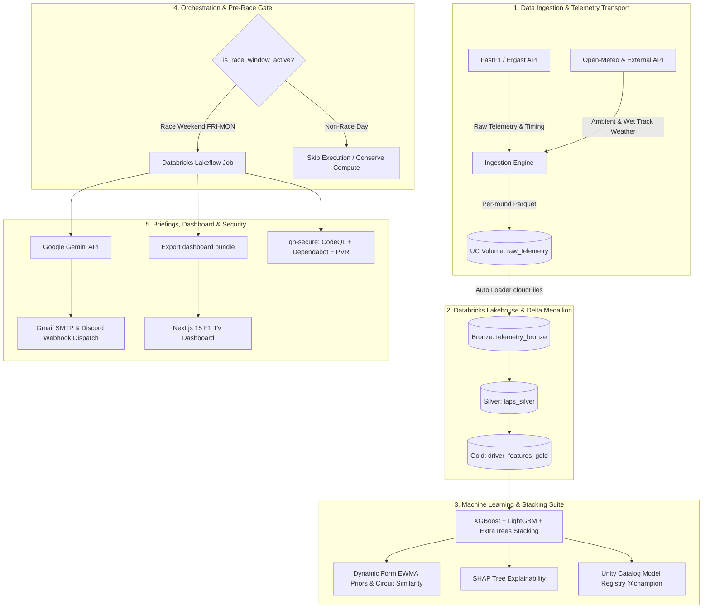

# F1 2026 Predictive Platform — End-to-End System Architecture

## Executive Architecture Summary

The **F1 2026 Predictive Platform** is an enterprise-grade data engineering, machine learning, and full-stack web application designed to forecast and analyze Formula 1 race performance hierarchies under the **2026 technical regulations**.

The system operates as an autonomous, event-driven pipeline that ingests telemetry, executes quantile regression models on a Databricks Lakehouse, registers champion model artifacts in Unity Catalog, generates structured LLM race briefings via Google Gemini, and deploys an interactive Next.js dashboard on Vercel.



---


## 1. Telemetry Ingestion & Data Engineering Pipeline

### 1.1 Ingestion Sources
- **FastF1 Ergast API**: Synchronizes lap times, sector split times (S1, S2, S3), trap speeds, tyre compounds, stint lengths, pit stop durations, and telemetry channels (Throttle, Brake, RPM, Gear, Speed).
- **Open-Meteo Weather API**: Retrieves air temperature, track surface temperature, humidity, wind vectors, and rainfall indicators for circuit coordinates.
- **Cloud Cache Layer**: Caches raw FastF1 payloads in a local directory (`fastf1_cache/`) backed up to a Supabase S3 bucket for warm serverless execution.
- **Unity Catalog `raw_telemetry` Volume**: completed-round FastF1 laps are landed as per-round Parquet under `/Volumes/<catalog>/<schema>/raw_telemetry`, which the Bronze layer tails with Auto Loader (job task 1, see §3.2). This is the real Bronze drop that closes the cloud self-learning loop; when a timing environment cannot supply lap data the round is skipped and post-race verdicts degrade to a positional-only `partial` status rather than inventing accuracy.

### 1.2 Delta Medallion Architecture (Databricks DLT)
1. **Bronze Layer (`telemetry_bronze`)**: Raw, append-only lap telemetry, streamed out of the `raw_telemetry` Volume by Auto Loader (`cloudFiles`) so original data types are preserved.
2. **Silver Layer (`laps_silver`)**: Cleaned and validated dataset with Delta Live Tables (DLT) quality expectations:
   - `expect_or_drop("valid_laptime", "LapTime_s > 45 AND LapTime_s < 200")`: Removes pit-in/out out-laps and safety car anomalies.
   - `expect_or_fail("valid_driver", "Driver IS NOT NULL")`: Ensures strict entity integrity.
3. **Gold Layer (`driver_features_gold`)**: Feature matrix engineered per driver per stint:
   - Rolling 3-lap and 5-lap exponentially weighted moving averages (`roll_laptime_3`, `roll_laptime_5`).
   - Sector split performance ratios.
   - Tyre degradation rate ($\text{slope} = \Delta t / \text{lap}$).
   - Downforce and track abrasiveness encodings.

---

## 2. Machine Learning Modeling & Uncertainty Engine

### 2.1 Model Selection & Justification
In accordance with empirical benchmarks on tabular data (Grinsztajn et al., 2022), tree-based ensemble algorithms significantly outperform deep neural networks on structured telemetry features.

| Model | Purpose | Quantile / Objective |
|---|---|---|
| **XGBoost Regressor** | Primary lap pace baseline | `reg:squarederror` |
| **LightGBM Quantile Regressors** | Uncertainty bounds (P05, P50, P95) | `quantile` ($\alpha = 0.05, 0.50, 0.95$) |
| **Stacking Pace Regressor** | Ensemble meta-learner | Ridge Regression meta-estimator |

### 2.2 Cross-Track Baseline Pace Normalization
To translate season-wide driver pace to a specific circuit's physical lap time baseline:

$$\text{Driver\_Delta}_i = \text{Median}(\text{LapTime}_{i, \text{season}}) - \text{Median}(\text{LapTime}_{\text{global, season}})$$

$$\text{Target\_Pace}_{i, \text{track}} = \text{Baseline}_{\text{historical, track}} + \text{Driver\_Delta}_i$$

### 2.3 Chronological Validation (Leakage Prevention)
Models are trained exclusively on historical seasons with known outcomes (e.g. 2022–2025) and tested on unseen future seasons (2026), preventing temporal data leakage.

---

## 3. Automated Scheduling & Race Weekend Auto-Gate

### 3.1 Race Weekend Auto-Gate (`is_race_window_active()`)
To prevent unnecessary compute usage and spurious notification alerts:
- The system queries `calendar.json` (synced via `src/scripts/sync_calendar.py`).
- **Active Window**: Friday 00:00 UTC through Monday 23:59 UTC on scheduled race weekends.
- **Behavior**: If executed on a non-race day (e.g. Wednesday of a gap week), the pipeline logs a clean skip notification and terminates gracefully with exit code 0.
- **Override**: Passing `--force` CLI flag bypasses the gate for manual testing and CI/CD verification.

### 3.2 Databricks Lakeflow Workflow (`f1_2026_race_predictions_job`)
The Databricks job is the **single scheduler** — the Trigger.dev orchestration and the GitHub Actions race cron have both been retired. Five tasks execute as one dependency graph:

- **Schedule**: Quartz cron `0 0 6 ? * FRI-MON` (race weekend + post-race Monday at 06:00 UTC).
- **Task 1 (`ingest_race_telemetry`)**: pulls the newest completed round from FastF1 and writes per-round Parquet into the Unity Catalog `raw_telemetry` Volume (`--run-mode ingest`).
- **Task 2 (`run_medallion_pipeline`)**: executes the DLT pipeline over that Volume (Bronze → Silver → Gold).
- **Task 3 (`train_and_register_champion`)**: fits the pace regressors, infers the MLflow signature (`infer_signature`), sets the registry URI to `databricks-uc`, and re-tags `@champion` in Unity Catalog (`<catalog>.race_pace.xgb_race_pace_regressor`) — **only when the candidate beats the incumbent's cross-validated RMSE**.
- **Task 4 (`dispatch_notifications`)**: reads credentials from the Databricks Secrets scope `f1_secrets` (`gmail_app_password`) and sends HTML email briefings and Discord alerts via SMTP/webhook.
- **Task 5 (`export_dashboard_data`)**: runs in parallel with task 4 and publishes the season's `reports/<season>` bundle to object storage for the dashboard (see §4.4).

### 3.3 GitHub Actions: Manual Fallback & Calendar Sync
- **`scheduled_sync.yml` — manual only.** The Friday/Monday race cron was removed alongside the Databricks consolidation; the workflow is kept as a `workflow_dispatch` fallback for replaying a single run by hand.
- **`sync_calendar.yml`** keeps its calendar cron so `calendar.json` continues to track the official FastF1/Ergast schedule.

---

## 4. Next.js Web Dashboard & Vercel Deployment

### 4.1 Rendering Strategy (SSG + ISR)
- **Static Site Generation (SSG)**: Pre-renders race pages at build time for instant global delivery via Vercel CDN.
- **Incremental Static Regeneration (ISR)**: Configured with `revalidate: 3600` (1 hour) to pick up new race artifacts without requiring full application rebuilds.

### 4.2 Available Race Discovery & Date-Gating (`getAvailableRaces`)
- **Pass 1**: Scans `reports/2026/summaries/` for `round_N` telemetry & report files.
- **Pass 2**: Scans `reports/2026/<race_dir>/results/predictions.csv`.
- **Date Guard**: Compares `race.isoDate` against current system time. Races scheduled in the future (e.g., Round 14 Spanish GP) remain **locked** until their scheduled race weekend arrives.

### 4.3 UI Component Hierarchy & State Management
- **Hero Card (`index.tsx`)**: Displays countdown timer to the current/next Grand Prix and links to the latest completed analysis.
- **Race Detail Page (`/race/[round]`)**:
  - **Metric Cards**: Predicted/Actual Winner, P2, and Fastest Lap. Automatically defaults to `"predicted"` mode when actual post-race results are pending.
  - **Race Timeline Chart (`RaceTimeline.tsx`)**: Canvas/Recharts visualization of lap-by-lap driver positions. Per-driver aggregation guarantees zero duplicate labels in the chart legend.
  - **Tyre Intelligence (`TyreIntelligence.tsx`)**: Visual breakdown of stint lengths, compounds (Hard/Medium/Soft), and pit stop windows.
  - **Finishing Order Table (`PredictionsTable.tsx`)**: Sortable classification grid with team color indicators and pace deltas.
  - **AI Race Analysis (`RaceReport.tsx`)**: High-impact markdown rendering of Google Gemini LLM briefings.

### 4.4 Dashboard Data Serving (Databricks → Object Storage → Vercel)
The dashboard no longer depends on a race-day GitHub Actions cron to refresh its data:

- **Publisher** (`src/f1_predictions/utils/dashboard_publish.py`): `--run-mode export` collects `reports/<season>/**`, discovers the completed rounds, uploads them under `dashboard/<season>/` through the shared `get_s3_client()` accessor, and writes `manifest.json` **last** as the completeness signal.
- **Consumer** (`dashboard/scripts/fetch-dashboard-data.mjs`): the dashboard `prebuild` step pulls that prefix. It is opt-in via `F1_DASHBOARD_DATA_BASE_URL`, refuses path traversal, and never breaks the build unless `F1_DASHBOARD_DATA_STRICT=1`.
- **Fallback**: the committed `reports/**` tree remains the source of truth whenever the base URL is unset, so the build works with no cloud configuration at all.

---

## 5. Security, Governance & Reliability

### 5.1 GitHub Security Lab Governance (`gh-secure`)
- **`SECURITY.md`**: Public vulnerability reporting policy and security disclosure protocol.
- **`dependabot.yml`**: Weekly automated dependency security updates for Python (`pip`/`uv`) and GitHub Actions.
- **`codeql.yml`**: Static security analysis pipeline for Python and GitHub Actions workflow files.
- **Branch Rulesets**: The `Master Protection & CI Gates` ruleset requires every change to land through a pull request and enforces linear history (merge commits are rejected), while blocking force-pushes and branch deletion. Merging is squash-only and head branches are deleted automatically. There is intentionally **no required approval count and no required status check**, so the "green CI before merge" rule is a convention documented in [`../CONTRIBUTING.md`](../CONTRIBUTING.md) rather than a hard gate.
- **CodeQL**: Runs the `security-extended,security-and-quality` query suites on every PR and fails the build on new alerts — including the name-based `py/clear-text-logging-sensitive-data` heuristic, which flags variables named like credentials even when only the name is logged.

### 5.2 LLM Fallback Chain (`call_ai_with_retry`)
1. **Primary Model**: `gemini-3.1-pro-preview` (high-reasoning narrative generation).
2. **Automated Fallback**: `gemini-3.5-flash` (triggered on quota exhaustion, 429 rate limits, or API outages).
3. **Deterministic Fallback**: Local structured template generator ensures valid markdown reports are published even during total upstream API outages.

### 5.3 Build Artifact Tracking (`.gitignore` Exceptions)
- Targeted git exceptions (`!reports/**/summaries/*.json`, `!reports/**/summaries/*.md`) ensure all generated telemetry files, lap timelines, tyre intelligence JSONs, and AI reports are tracked in version control and deployed to Vercel.

---

## 6. System Verification & Test Suite

The project enforces strict code quality and test coverage across the entire stack:

```bash
# Execute unit & integration test suite (331 tests across ML, cleaning, pipeline & AI)
uv run pytest

# Execute strict MyPy type check (0 issues across source files)
uv run mypy --strict src

# Execute Ruff code linter
uv run ruff check .

# Execute TypeScript type checker via pnpm (Zero-npm policy)
pnpm --filter dashboard exec tsc --noEmit

# Execute Next.js production build via pnpm
pnpm --filter dashboard run build
```

All 331 Python tests pass under an enforced **80% line-coverage gate** (current: 84.2%), with 0 MyPy `--strict` errors, a clean Ruff lint/format check, and pnpm workspace verification.

